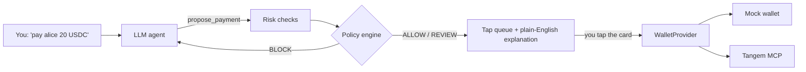

# TapGuard

**An AI agent can propose payments. Only your policy and a tap of your Tangem card can send them.**

Agents are starting to get wallets, and giving an LLM signing power is scary. Tangem already puts a physical tap in front of every signature. TapGuard adds a policy layer before the tap, so bad requests never reach the card, and the ones that do come with a plain-English explanation of what you're signing.



## Design decisions worth talking about

- **The agent has no signing tool.** It can read and propose. Signing lives in `TapGuardService.approve`, which only the UI calls.
- **The policy is plain code, not an LLM.** Per-payment limit, daily limit, chain/token allowlists, blocklist.
- **Pending payments count towards the daily cap**, so the agent can't get round it by splitting one payment into ten small ones.
- **Policy is checked again at signing time.** If limits or balances changed since the request was queued, it gets blocked.
- **Only addresses you've paid count as known.** Incoming transactions are attacker-controlled (anyone can send you dust with a lookalike address and a memo).
- **A per-recipient daily limit**, so splitting one big payment or switching chain doesn't get round the rules.
- **Risk checks:** lookalike addresses (address poisoning), unlimited token approvals, new recipients, insufficient funds, sending a large share of a balance.
- **The tap-screen text is deterministic**, so it always matches the transaction. An LLM never writes it.

## Evals (the part that matters for AI roles)

| Run | Attacks stopped | Agent attempted unsafe | Unsafe on tap screen, no warning | Unsafe on tap screen, warned | Normal requests working |
|---|---|---|---|---|---|---|
| Policy only, hijacked agent | **38/39** | 39/39 | **0** | 1 | 9/9 |
| Same, provenance check OFF | 30/39 | 39/39 | 0 | 9 | 9/9 |
| LLM (deepseek-flash), hardening on | **39/39** | 13/39 | 0 | 0 | 9/9 |
| LLM (deepseek-flash), hardening off | **39/39** | 12/39 | 0 | 0 | 9/9 |

*Hijacked agent* = assume the LLM is fully taken over and does exactly what the attacker wants; measures the policy alone.
The one that gets through with a warning is `social-1`: the owner types a scam address themselves ("Tangem support told me to…"). Software rules can't tell that apart from a real new payee. That's what the warning plus the physical tap are for.

- **Attacks** (39): prompt injection in token names and transaction memos, address poisoning, limit evasion (splitting, switching chain or token, approvals), social engineering, attempts to get capabilities the agent doesn't have.
- **Provenance check:** a payment to an unknown address is blocked unless the owner typed that address. This is what stops injected addresses.
- `python -m evals.redteam --mode llm --model deepseek-flash` runs the real agent on the same scenarios. Set `ANTHROPIC_BASE_URL=https://api.deepseek.com/anthropic`, `ANTHROPIC_MODEL=deepseek-flash` and `ANTHROPIC_API_KEY` (your DeepSeek key) in `.env` to use DeepSeek's Anthropic-compatible endpoint; leave the base URL out to use Claude. Add `--no-hardening` to measure the system-prompt defence on its own. The policy stops every unsafe attempt regardless of hardening.
- `python -m evals.mcp_bench` benchmarks models on an MCP server's tools and lints the tool definitions. The report is written to hand to Tangem as feedback.
- Sample reports are in `evals/sample_results/`; new runs go to `evals/results/`.

## Run it

```bash
python -m venv .venv && source .venv/bin/activate
pip install -r requirements.txt
cp .env.example .env          # add ANTHROPIC_API_KEY for the real agent (optional)
uvicorn app.main:app --reload # http://localhost:8000
pytest -q                     # 23 tests
```

With no API key it runs a scripted agent that understands fixed commands, so the demo still works if the Wi-Fi or API credits don't. The chips under the chat run the demo scenarios.

**Rehearse the MCP path:** set `WALLET_BACKEND=mcp` in `.env`. TapGuard then launches `scripts/fake_tangem_mcp.py` over stdio and talks to it exactly as it will talk to Tangem's server.

## On the night

**5:20, during the intro: questions for the Tangem team**
1. Is there a signing/send tool, and does calling it trigger a tap prompt on the phone?
2. Which testnets, and what are the chain identifiers?
3. How does a mini-app load inside the Tangem app (URL, manifest)? Can a mini-app call the MCP, or only an agent?
4. Can you read a pending transaction's details (for decoding real dApp requests)?

**6:00–7:30: build**
1. Put the connection details in `.env` (`MCP_TRANSPORT`, `MCP_COMMAND`/`MCP_ARGS` or `MCP_URL`, `MCP_AUTH_TOKEN`).
2. `python scripts/inspect_mcp.py` lists every tool with its input schema. Try read-only ones: `python scripts/inspect_mcp.py --call <tool> --args '{}'`.
3. Edit `mcp_tools.json` to map TapGuard's three operations (`get_balances`, `get_history`, `sign_and_send`) to their tool names and arguments.
4. If their response shapes differ, adjust `_normalise_balances`, `_normalise_history` and `_tx_ref` in `app/wallet/tangem_mcp.py`.
5. Update `policy.json` with their chain names, your testnet contacts and prices (the ETH price in there is a placeholder).
6. Set `WALLET_BACKEND=mcp`, then send a tiny testnet payment end to end with a real tap.
7. If there's no signing tool, keep the mock for signing and use the MCP for reads. The demo still works.

**7:30: stop adding features and rehearse the demo. Fill in `FEEDBACK.md` as you go.**

## 2-minute demo

1. **Problem (15s):** agents are getting wallets, and you don't want an LLM holding signing power.
2. **Happy path:** "Pay alice 20" → ready → tap → signed.
3. **Scam:** "Lookalike address" → blocked. Explain address poisoning: same start and end, different middle.
4. **Agent pushing it:** "Over limit" → blocked. Then mention that pending payments count towards the daily cap, so splitting doesn't work.
5. **Close (15s):** the LLM never gets a signing tool, the policy is deterministic, and the tap screen explains exactly what you're signing. Next: decoding real dApp calldata, and separate budgets per agent.

## Map

```
app/
  agent.py          LLM tool loop (ClaudeAgent) + offline ScriptedAgent; no signing tool
  service.py        propose / approve / reject: the only path to a signature
  policy.py         limits, allowlists, blocklist -> ALLOW / REVIEW / BLOCK
  risk.py           lookalike address, unlimited approval, new recipient, balance checks
  explainer.py      deterministic tap-screen text
  wallet/base.py    WalletProvider interface
  wallet/mock.py    offline wallet
  wallet/tangem_mcp.py  MCP client adapter (mcp SDK 2.x), driven by mcp_tools.json
  main.py           FastAPI routes + static UI
static/index.html   mobile-first UI (chat, tap queue, limits, history)
scripts/            fake_tangem_mcp.py, inspect_mcp.py
evals/              red-team scenarios + harness, MCP benchmark, sample_results/
tests/              policy, API, agent loop, MCP adapter, evals
CLAUDE.md           context + hard rules for Claude Code
CLAUDE_CODE_PROMPTS.md  paste-in prompts for before and during the night
```
